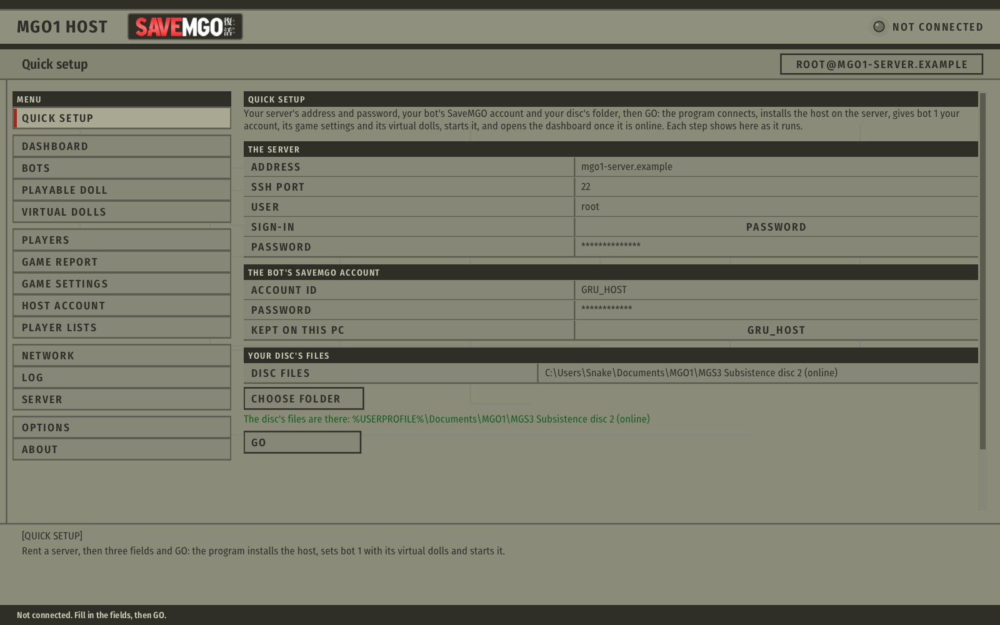
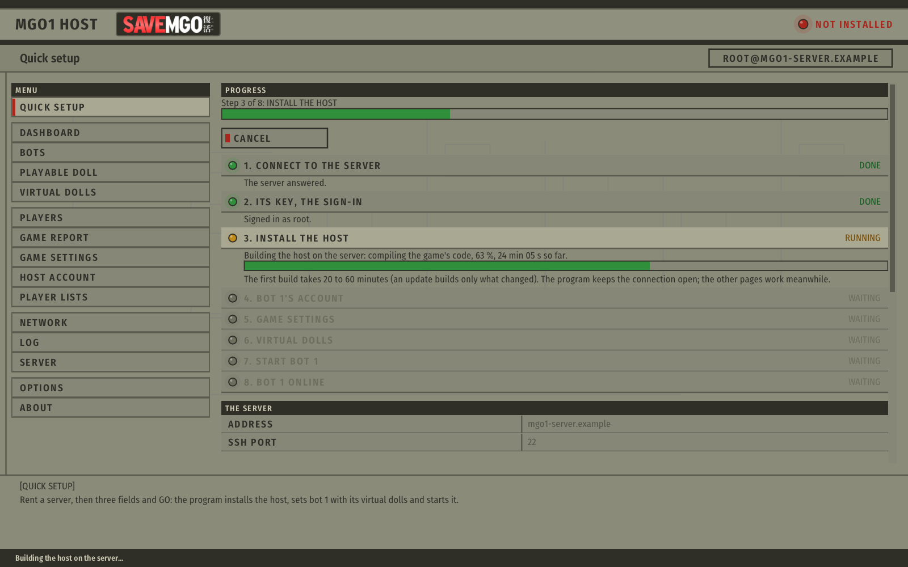
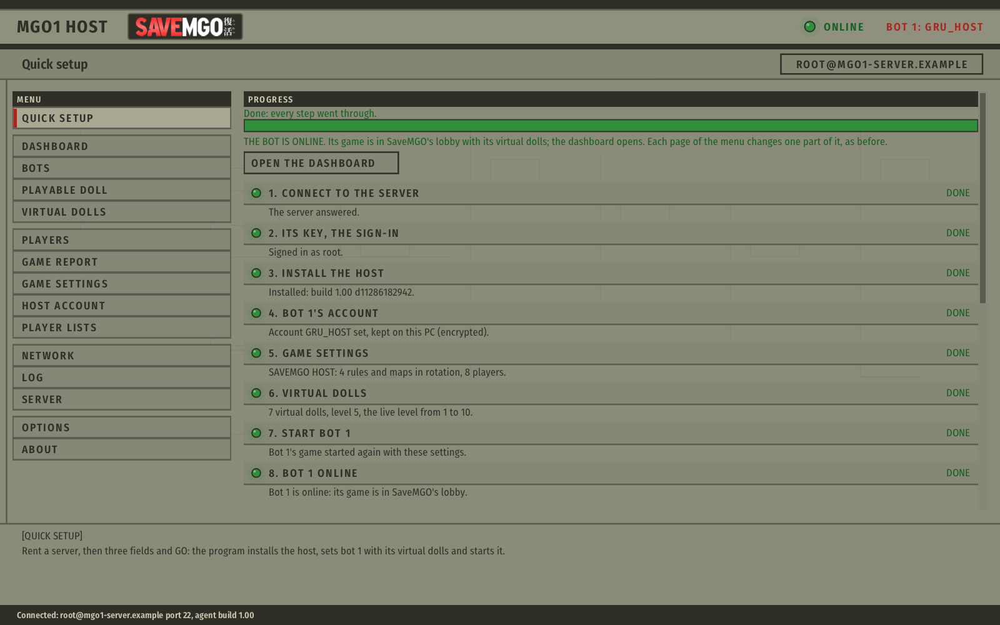
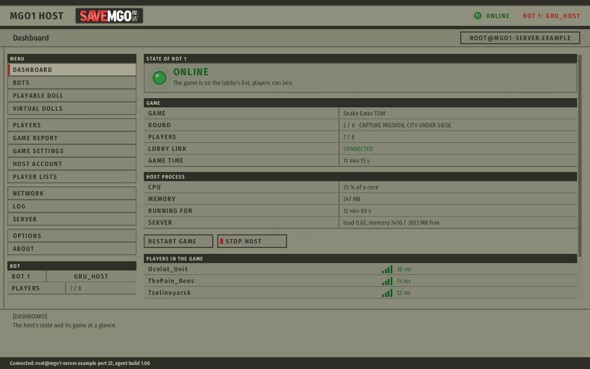
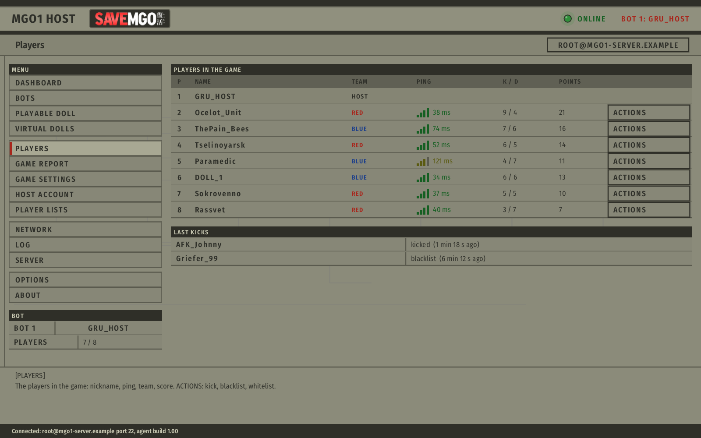
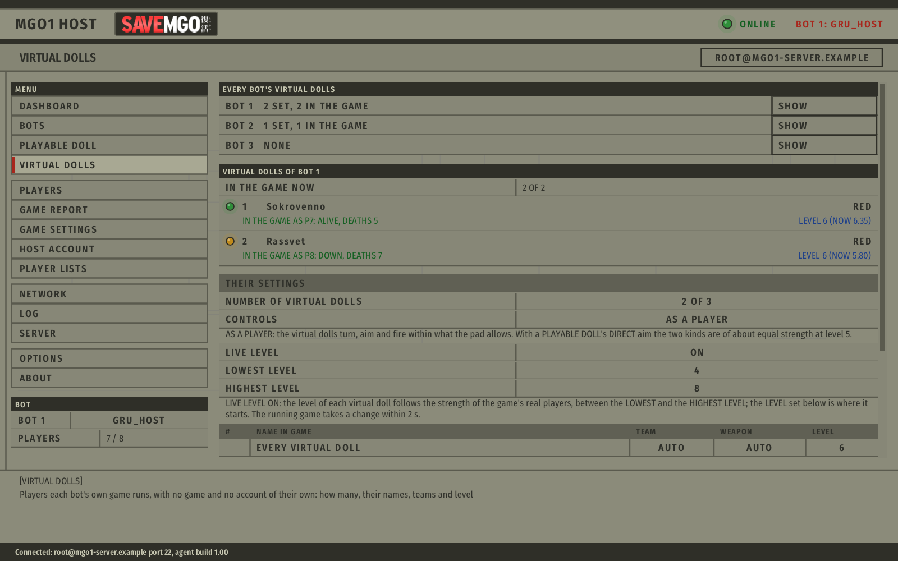
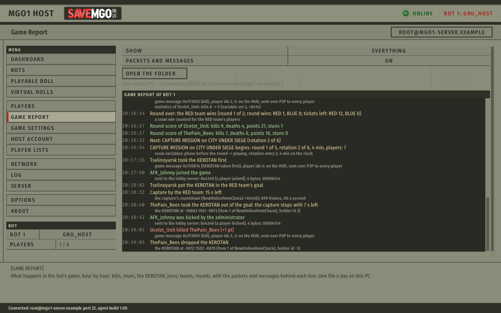
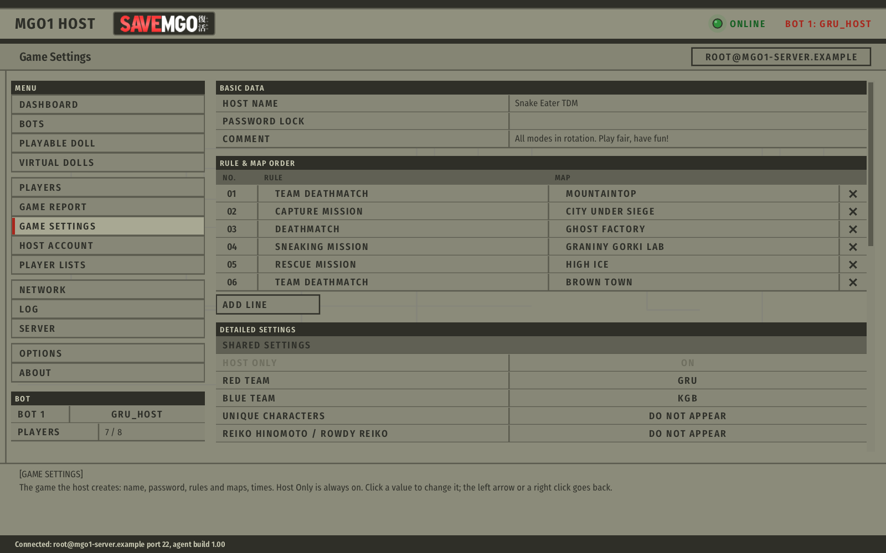

[English](README.md) | 日本語

# MGO1 Host

MGO1 Host は、METAL GEAR ONLINE（PS2 版の MGO、以下 MGO1）のゲームを、あなたが借りた Linux サーバーから SaveMGO 上で24時間ホストし続けるためのものです。空いた席はボットが埋め、本物のプレイヤーと同じルールでプレイします。デスクトップ用のプログラムを使えば、3クリックですべてセットアップできます。

最新リリース：**build 1.00**

> SaveMGO コミュニティによる無料・非営利のファンプロジェクトです。株式会社コナミデジタルエンタテインメント（Konami Digital Entertainment Co., Ltd.）および Sony Interactive Entertainment とは関係がなく、両社による推奨、後援、承認を受けたものではありません。METAL GEAR、METAL GEAR SOLID、METAL GEAR ONLINE および KONAMI は、株式会社コナミデジタルエンタテインメントの商標または登録商標です。PlayStation は株式会社ソニー・インタラクティブエンタテインメント（Sony Interactive Entertainment Inc.）の登録商標です。
>
> **このリポジトリとそのダウンロードには、ゲームのコードもデータも一切含まれていません。** ホストは**あなた自身のサーバー上で、あなた自身の MGO1 ディスクから**ビルドされます。そこからビルドされたものは、あなた自身が使うためのものであり、他の人と共有するためのものではありません。

## 概要

ホストボットは、あなたのディスクからビルドした MGO1 自身のコードで動きます。Linux サーバー上で画面を持たずに（ヘッドレスで）動き、SaveMGO のロビーにゲームを立てます。PS2 と PCSX2 のプレイヤーは、ほかのゲームと同じように参加できます。1台のサーバーで最大10体のボットを動かせ、ボットごとに専用のゲーム、SaveMGO アカウント、UDP ポートを持ちます。

バーチャルドールは、空いた席を埋めるボットです。プレイヤーと同じルールのもと、1から10のレベルでプレイし、本物のプレイヤーが席を必要とするときには退出します。

MGO1 Host は、SSH 経由でボットのインストール、設定、監視を行うためのプログラムです。Windows、Linux、macOS で動き、11言語に対応しています。日本語にも対応していて、OPTIONS（オプション）の LANGUAGE（言語）で切り替えられます。この README では、ボタンやページの名前を英語表示のまま書いています。

## 必要なもの

- 自分の MGO1 ディスク：北米版のオンラインディスク（メタルギア ソリッド3 サブシスタンス）で、中のファイルをフォルダーにコピーしたもの。日本版のディスクではホストをビルドできません。
- Linux サーバー（[借りるサーバーの選び方](#借りるサーバーの選び方)を参照）と、ボット1体につき1つの SaveMGO アカウント。
- MGO1 Host 本体を動かす PC：Windows 10 または 11、Linux、macOS のいずれか。

## クイックスタート

1. Linux サーバーを借ります。条件は x86-64、Ubuntu 24.04、root 権限、2コア、メモリ 2 GB、空きディスク 3 GB、UDP ポート 5730 から 5739 が開いていることです。おすすめは[借りるサーバーの選び方](#借りるサーバーの選び方)にあります。
2. [リリース](https://github.com/snakeswiss/mgo1-host/releases)から MGO1 Host をダウンロードして展開し、`MGO1 Host` を起動します。QUICK SETUP（クイックセットアップ）のページが開きます。
3. 3つの欄を入力して GO を押します。入力するのは、サーバーのアドレスと root パスワード、ボットの SaveMGO アカウント、MGO1 ディスクのフォルダー（北米版のオンラインディスクで、`MGS` と `MODULES` が入っているフォルダー）です。

GO を押すと、すべてがインストールされ、ボット1がバーチャルドール7体とともに起動します。初回は2コアで約35分かかります。サーバーがあなたのディスクのファイルからホストをビルドするためです。アップデートは約8分で終わります。途中のステップで失敗した場合は、どうすればよいかがページに表示されます。もう一度 GO を押すと、そのステップから再開します。

| | |
|---|---|
|  |  |
| 3つの欄を入力して GO | サーバーがディスクのファイルからホストをビルド |

## 借りるサーバーの選び方

プレイヤーはボットに接続するので、サーバーの場所でプレイヤーの ping が決まります。理想は、ヨーロッパ、アメリカ、日本に1台ずつサーバーを置くことです。どのゲームも同じ SaveMGO ロビーに表示されるので、地域ごとの名前（`EU DM 1`、`US DM 1`、`JP DM 1`）を付けておけば、プレイヤーは一番近いゲームを選べます。

| 地域 | サーバー | 場所 | vCPU、メモリ | ボット数 | 月額（EUR） | 月額（USD） | 月額（JPY） |
|---|---|---|---|---|---|---|---|
| ヨーロッパ | Hetzner CX23 | ドイツ、フィンランド | 2、4 GB | 約3 | 5.49 | 6.49 | 約965 |
| ヨーロッパ | Hetzner CX33 | ドイツ、フィンランド | 4、8 GB | 約6 | 8.49 | 9.99 | 約1,490 |
| アメリカ | Hetzner CPX11 | アッシュバーン、ヒルズボロ | 2、2 GB | 約3 | 17.49 | 20.49 | 約3,270 |
| アメリカ | Hetzner CPX21 | アッシュバーン、ヒルズボロ | 3、4 GB | 約5 | 31.99 | 37.49 | 約5,980 |
| 日本 | Vultr Regular 2 vCPU 4 GB | 東京、大阪 | 2、4 GB | 約3 | 約18.15 | 20.00 | 約3,190 |
| 日本 | ConoHa VPS 2 GB | 東京 | 3、2 GB | 約3 | 約11.57 | 約12.74 | 2,033 |
| 日本 | ConoHa VPS 4 GB | 東京 | 4、4 GB | 約6 | 約20.53 | 約22.62 | 3,608 |

料金はすべて**月額**で、2026年11月18日に各社のサイトで確認したものです。Hetzner と Vultr は税抜き（Hetzner は IPv4 アドレスが別料金）、ConoHa は税込みです。請求は各社の通貨で行われます（Hetzner は EUR または USD、Vultr は USD、ConoHa は JPY）。「約」の付いた金額は、日本銀行の2026年11月16日の相場（1 USD = 159.5 JPY、1 EUR = 175.75 JPY）で換算したものです。料金は変わることがあるので、注文する前に各社のサイトで確認してください。

日本のプレイヤー向けには、東京か大阪のサーバー（表の「日本」の行）をおすすめします。日本のサーバーのうち、Vultr のサイトは英語、ConoHa のサイトはほぼ日本語です。

サーバーを2台だけにするなら、Hillsboro（ヒルズボロ、米国西部）は日本からも約100から135 ms で接続できます。Ashburn（アッシュバーン、米国東部）はヨーロッパに近い場所です。

その他の国については、[OneProvider](https://oneprovider.com) が約140都市（東京、香港、シンガポール、ムンバイ、ヨーロッパや南北アメリカの多くの都市）に専用サーバーを用意しています。料金は都市によって EUR または USD です。利用できるようになるまで、数時間から1日ほどかかることがあります。

サーバーが次の条件を満たしていれば、ほかの事業者でもかまいません。x86-64（Hetzner の CAX のような Arm は不可）、Ubuntu 24.04、2コア、メモリ 2 GB 以上、空きディスク約 3 GB、パブリック IPv4、UDP 5730 から 5739 が開いていること。コア数が多いほど、最初のビルドが短く済みます。

## スクリーンショット

| | |
|---|---|
|  |  |
| QUICK SETUP 完了：ボット1がバーチャルドールとともにオンライン | ダッシュボード：ボットの状態、ゲーム、プレイヤー |
|  |  |
| プレイヤーの ping、チーム、スコア。キック、ブラックリスト、ホワイトリストへの登録も | バーチャルドール：人数、レベル、ライブレベル |
|  |  |
| Game Report（ゲームレポート）：キル、スタン、ラウンド、KEROTAN | ゲーム設定：名前、ルールとマップ、すべてのホストオプション |

## 自分でビルドする

何もビルドする必要はありません。QUICK SETUP があなたのサーバー上でホストをビルドします。自分でビルドしたい場合は Ubuntu 24.04 を使ってください。Windows では、PowerShell で `wsl --install -d Ubuntu-24.04` を一度だけ実行し、そのあと Ubuntu で同じコマンドを入力します。

GitHub の「Source code」の zip ではなく、git clone したものからビルドしてください。ビルドの日付はコミットから取られるためです。`build_server.sh` には sudo が必要です（コンパイラーがなければ apt でインストールします）。そのため、ビルドフォルダーの所有者は root になります。自分でビルドしたホストにはゲームのコードが含まれているので、自分のサーバーだけで使ってください。

```bash
git clone https://github.com/snakeswiss/mgo1-host.git && cd mgo1-host

# MGO1 Host, the program (no disc needed)
sudo apt install g++-mingw-w64-x86-64 binutils-mingw-w64-x86-64 g++ cmake make perl git python3 \
    libx11-dev libxrandr-dev libxinerama-dev libxcursor-dev libxi-dev libxext-dev
bash hostpanel/build.sh          # hostpanel/build/MGO1 Host.exe (Windows)
bash hostpanel/build_linux.sh    # hostpanel/build-linux/mgo1-host (Linux)

# the host, mgo1host.exe, from your disc (/path/to/disc: the folder holding MGS and MODULES)
python3 tools/server_src.py --out mgo1host-src.tar.gz
sudo bash host/build_server.sh --src mgo1host-src.tar.gz --disc /path/to/disc --out mgo1host.exe --tree ~/mgo1host-build

# the package, out/MGO1 Host (MGO1 Host.exe and server/)
bash hostpanel/package.sh --source mgo1host-src.tar.gz --out out   # the public kind: the server builds the host
bash hostpanel/package.sh --host-exe mgo1host.exe --out out       # with your own host: for your own servers only
```

上のコマンドの意味は次のとおりです。最初のブロックは MGO1 Host 本体のビルドで、ディスクは要りません。2つ目のブロックはディスクからホスト（mgo1host.exe）をビルドします（`/path/to/disc` は `MGS` と `MODULES` が入っているフォルダー）。3つ目のブロックはパッケージ（out/MGO1 Host）を作ります。`--source` は公開用の形で、ホストはサーバー側でビルドされます。`--host-exe` は自分でビルドしたホストを入れる形で、自分のサーバー専用です。

### Mac の場合

MGO1 Host は Mac でもビルドできます（macOS 10.15 以降。Apple シリコンと Intel の両方で動く1つのアプリになります）。パスにスペースを含まないフォルダーにリポジトリをクローンし、ターミナルで次を実行します。

```bash
xcode-select --install          # once: Apple's command line tools
brew install cmake              # once: cmake from Homebrew (https://brew.sh)
bash hostpanel/build_macos.sh   # ARCHS=arm64 or ARCHS=x86_64 builds for one kind of Mac only (quicker)
```

最初の2行は一度だけ実行すれば十分です（Apple のコマンドラインツールと、Homebrew の cmake）。`ARCHS=arm64` または `ARCHS=x86_64` を付けると、片方の種類の Mac 向けだけをビルドします（そのぶん速く終わります）。

初回のビルドには数分かかります（OpenSSL、libssh2、GLFW、Dear ImGui を取得してビルドするため）。アプリは `hostpanel/build-macos/MGO1 Host/MGO1 Host.app` にできます。その `MGO1 Host` フォルダーを別の場所にコピーし（次にビルドすると中身が空になるため）、リリースの Windows 版か Linux 版のパッケージに入っている `server` フォルダーを `MGO1 Host.app` の隣に置いてください。QUICK SETUP はそこを探します。リポジトリの GitHub Actions のワークフローが、変更のたびに同じアプリをビルドしています（Actions タブ）。

このアプリはアドホック署名で、公証（notarization）は受けていません。自分の Mac でビルドした場合は普通に開けます。ブラウザーでダウンロードしたコピーは macOS によって隔離（quarantine）されるので、最初に起動する前にターミナルで `xattr -dr com.apple.quarantine "/path/to/MGO1 Host"` を実行してください。

詳しくは [`hostpanel/README.md`](hostpanel/README.md#building-it)（プログラムと macOS について）と [`host/README.md`](host/README.md)（サーバー側とサーバー上でのビルドについて）にあります（どちらも英語です）。テストは `tests/` にあり、各ファイルの最初の数行に実行方法が書いてあります。

## ドキュメント

以下のドキュメントは英語で書かれています。

| ドキュメント | 内容 |
|---|---|
| [`hostpanel/README.md`](hostpanel/README.md) | MGO1 Host：すべてのページの説明、サーバーのセットアップ手順、プログラムのビルド |
| [`host/README.md`](host/README.md) | サーバー側：インストール、サービス、`mgo1hostctl`、設定 |
| [`docs/CRASH_REPORTS.md`](docs/CRASH_REPORTS.md) | クラッシュレポート |
| [`docs/releases/build-1.00.md`](docs/releases/build-1.00.md) | build 1.00 の新機能 |

## クレジットとライセンス

METAL GEAR ONLINE を今も守り続けている SaveMGO コミュニティに感謝します。

MGO1 Host は Dear ImGui (MIT)、GLFW (zlib)、libssh2 (BSD-3-Clause)、OpenSSL (Apache-2.0)、miniaudio (MIT-0)、stb (MIT)、Fira Sans Condensed と Fira Mono (SIL Open Font License 1.1) を使用しています。

ホストは Opus（[`docs/licenses/Opus.txt`](docs/licenses/Opus.txt)）、Recast & Detour（zlib、`MGO1Loader/recast/License.txt`）、Khronos の OpenGL ヘッダー（ライセンスはファイル内に記載）、DejaVu Sans のグリフ（[`docs/licenses/DejaVu.txt`](docs/licenses/DejaVu.txt)、Bitstream Vera ライセンス）を使用しています。
