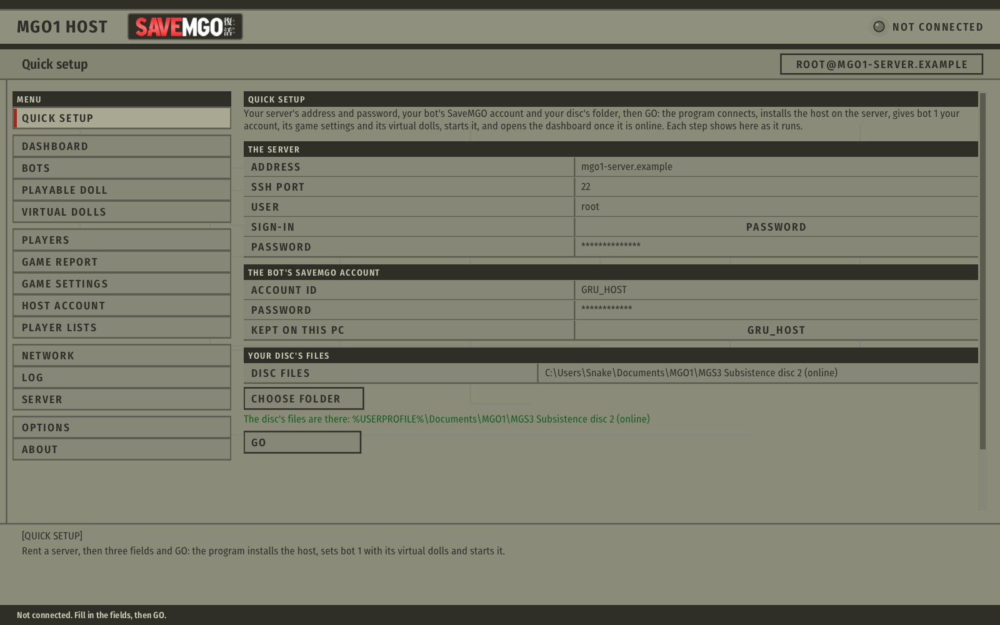
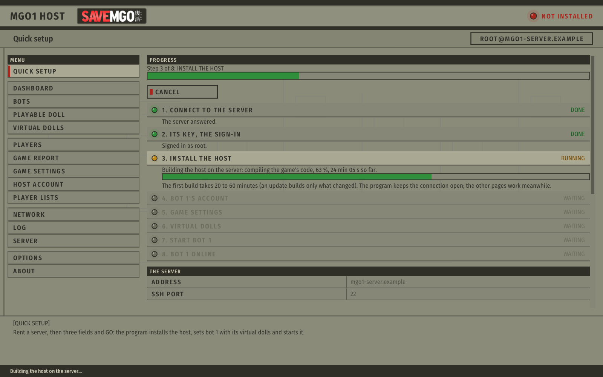
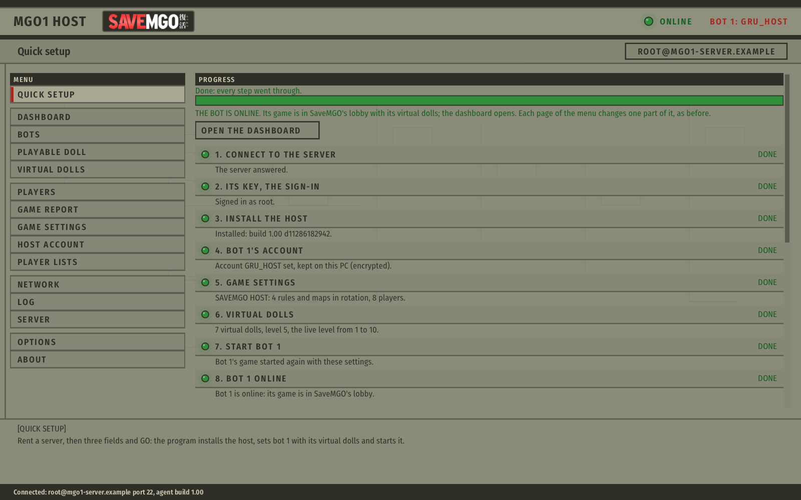
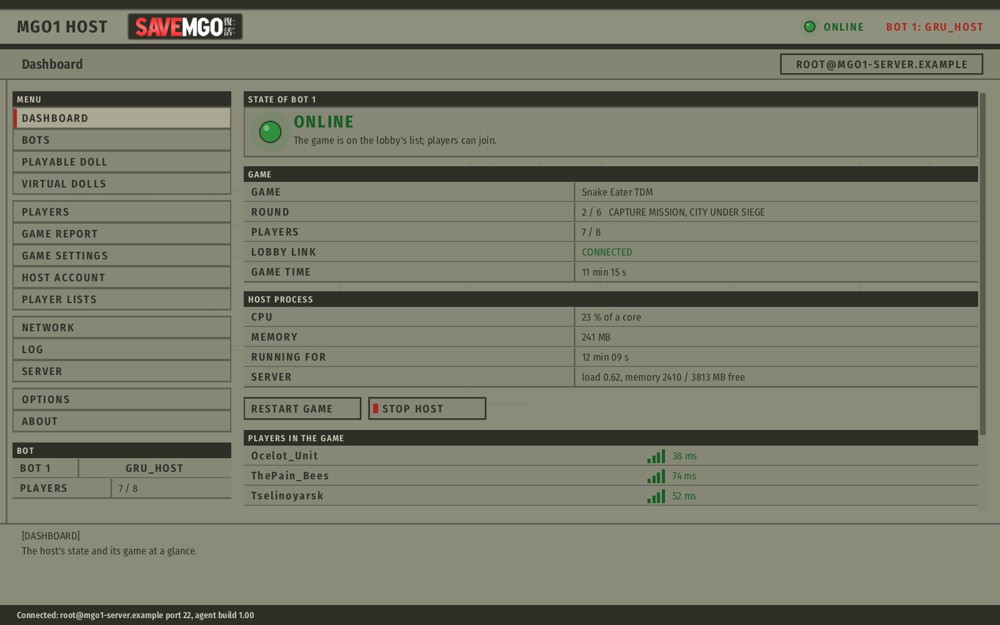
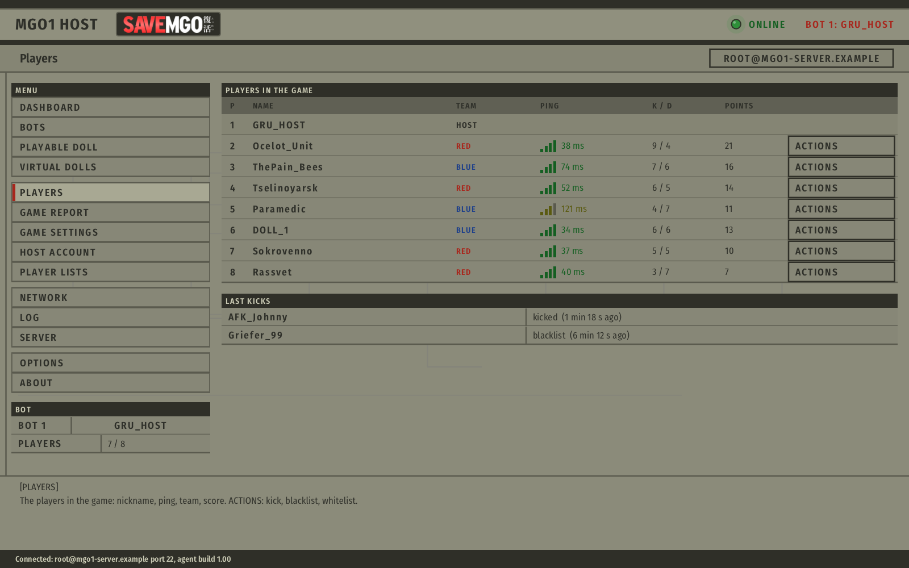
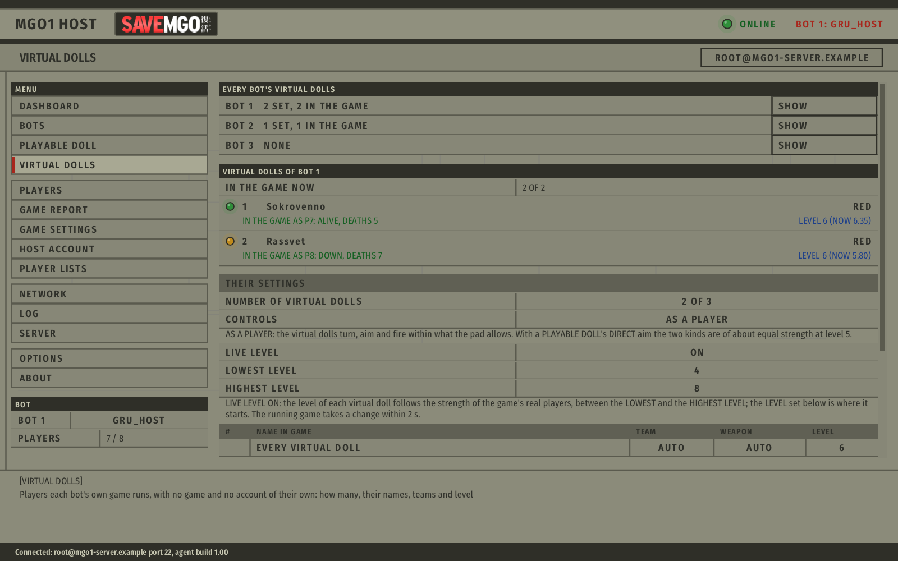
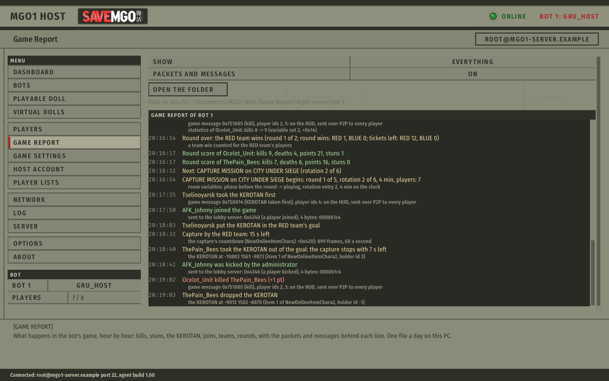
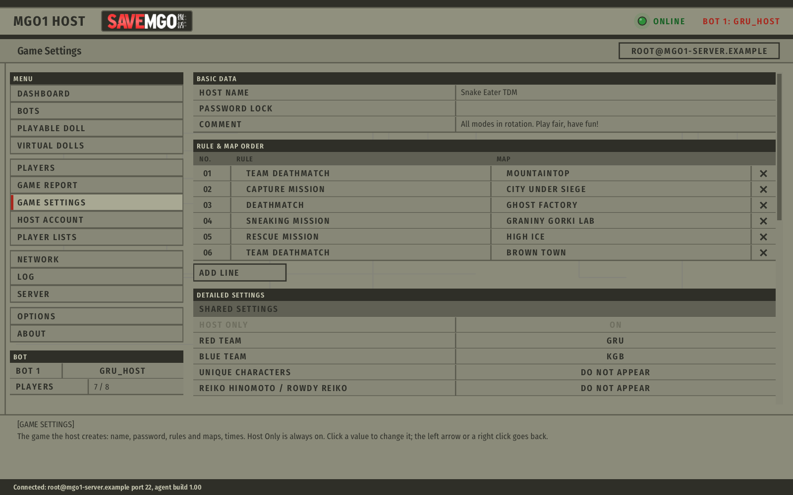

English | [日本語](README.ja.md)

# MGO1 Host

MGO1 Host runs Metal Gear Online (PS2) games on SaveMGO around the clock, from a Linux server you rent. Bots fill the
empty seats and play by the same rules as real players. A desktop program sets it all up in three clicks.

Latest release: **build 1.00**

> A free, non-commercial fan project of the SaveMGO community, not affiliated with, endorsed, sponsored or approved by
> Konami Digital Entertainment Co., Ltd. or Sony Interactive Entertainment. METAL GEAR, METAL GEAR SOLID, METAL GEAR
> ONLINE and KONAMI are trademarks or registered trademarks of Konami Digital Entertainment Co., Ltd. PlayStation is a
> registered trademark of Sony Interactive Entertainment Inc.
>
> **This repository and its downloads hold no code and no data of the game.** The host is built **on your own server
> from your own MGO1 disc**: what is built from it is yours to use, not to share.

## What it is

The host bot runs MGO1's own code, built from your disc. It runs headless on a Linux server and hosts a game in
SaveMGO's lobby, and PS2 and PCSX2 players join it like any other game. One server can run up to 10 bots, each with its own game,
SaveMGO account and UDP port.

Virtual dolls are bots that take the empty seats. They play by the same rules as players, at a level from 1 to 10, and
leave when a real player needs the seat.

MGO1 Host is the program you use to install, configure and watch your bots over SSH. It runs on Windows, Linux and
macOS, in 11 languages.

## Requirements

- Your own MGO1 disc: the North American online disc (MGS3 Subsistence), with its files in a folder.
- A Linux server (see [Which server to rent](#which-server-to-rent)) and one SaveMGO account per bot.
- For MGO1 Host itself: Windows 10 or 11, Linux or macOS.

## Quick start

1. Rent a Linux server: x86-64, Ubuntu 24.04, root access, 2 cores, 2 GB of memory, 3 GB of free disk, and UDP ports
   5730 to 5739 open. [Which server to rent](#which-server-to-rent) has some suggestions.
2. Download MGO1 Host from the [release](https://github.com/snakeswiss/mgo1-host/releases), unzip it and start
   `MGO1 Host`. It opens on the QUICK SETUP page.
3. Fill in the three fields and press GO: your server's address and root password, the bot's SaveMGO account, and your
   MGO1 disc's folder (the North American online disc: the folder that holds `MGS` and `MODULES`).

GO installs everything and starts bot 1 with 7 virtual dolls. The first time takes about 35 minutes on 2 cores, because
your server builds the host from your disc's files. Updates take about 8 minutes. If a step fails, the page tells you
what to do, and pressing GO again starts from that step.

| | |
|---|---|
|  |  |
| Three fields and GO | The server builds the host from your disc's files |

## Which server to rent

Players connect to the bot, so where the server is decides their ping. Ideally you have one server in Europe,
one in the USA and one in Japan. All games show up in the same SaveMGO lobby, so name them by region (`EU DM 1`,
`US DM 1`, `JP DM 1`) and players pick the nearest one.

| Region | Server | Where | vCPU, memory | Bots | EUR a month | USD a month | JPY a month |
|---|---|---|---|---|---|---|---|
| Europe | Hetzner CX23 | Germany, Finland | 2, 4 GB | about 3 | 5.49 | 6.49 | about 965 |
| Europe | Hetzner CX33 | Germany, Finland | 4, 8 GB | about 6 | 8.49 | 9.99 | about 1,490 |
| USA | Hetzner CPX11 | Ashburn, Hillsboro | 2, 2 GB | about 3 | 17.49 | 20.49 | about 3,270 |
| USA | Hetzner CPX21 | Ashburn, Hillsboro | 3, 4 GB | about 5 | 31.99 | 37.49 | about 5,980 |
| Japan | Vultr Regular 2 vCPU 4 GB | Tokyo, Osaka | 2, 4 GB | about 3 | about 18.15 | 20.00 | about 3,190 |
| Japan | ConoHa VPS 2 GB | Tokyo | 3, 2 GB | about 3 | about 11.57 | about 12.74 | 2,033 |
| Japan | ConoHa VPS 4 GB | Tokyo | 4, 4 GB | about 6 | about 20.53 | about 22.62 | 3,608 |

All prices are **per month**, checked on 18 November 2026 on the providers' sites: Hetzner and Vultr before tax
(Hetzner's IPv4 address extra), ConoHa tax included. Each provider bills in its own currency (Hetzner EUR or USD, Vultr
USD, ConoHa JPY). The "about" prices are converted at the Bank of Japan's rates of 16 November 2026 (1 USD = 159.5 JPY,
1 EUR = 175.75 JPY). Prices change, so check the provider's site before you order.

If you only want two servers, Hillsboro (US West) also serves Japan at about 100 to 135 ms. Ashburn (US East) is nearer
to Europe. For Japan, Vultr's site is in English; ConoHa's is mostly in Japanese.

For other countries, [OneProvider](https://oneprovider.com) has dedicated servers in about 140 cities (Tokyo, Hong Kong,
Singapore, Mumbai, many in Europe and the Americas), priced in EUR or USD depending on the city. Delivery can take from
a few hours to a day.

Any other provider will do if the server is x86-64 (not Arm, such as Hetzner's CAX) with Ubuntu 24.04, 2 cores, 2 GB of
memory or more, about 3 GB of free disk, a public IPv4 and UDP 5730 to 5739 open. More cores make the first build
shorter.

## Screenshots

| | |
|---|---|
|  |  |
| QUICK SETUP done: bot 1 is online with its virtual dolls | The dashboard: the bot's state, its game and players |
|  |  |
| Players with ping, team and score; kick, blacklist or whitelist them | Virtual dolls: how many, their level, the live level |
|  |  |
| The Game Report: kills, stuns, rounds, the KEROTAN | The game settings: name, rules and maps, every host option |

## Building

You don't have to build anything: QUICK SETUP builds the host on your server. If you want to build it yourself, use
Ubuntu 24.04. On Windows, run `wsl --install -d Ubuntu-24.04` once in PowerShell, then type the same lines in Ubuntu.

Build from a git clone, not from GitHub's "Source code" zip, because the build takes its date from the commit.
`build_server.sh` needs sudo (it installs its compiler with apt if it is missing), so its build folder belongs to root.
A host you built contains the game's code: keep it for your own servers.

```bash
git clone https://github.com/snakeswiss/mgo1-host.git && cd mgo1-host

# MGO1 Host, the program (no disc needed)
sudo apt install g++-mingw-w64-x86-64 binutils-mingw-w64-x86-64 g++ cmake make perl git python3 \
    libx11-dev libxrandr-dev libxinerama-dev libxcursor-dev libxi-dev libxext-dev
bash hostpanel/build.sh          # hostpanel/build/MGO1 Host.exe (Windows)
bash hostpanel/build_linux.sh    # hostpanel/build-linux/mgo1-host (Linux)

# the host, mgo1host.exe, from your disc (/path/to/disc: the folder holding MGS and MODULES)
python3 tools/server_src.py --out mgo1host-src.tar.gz
sudo bash host/build_server.sh --src mgo1host-src.tar.gz --disc /path/to/disc --out mgo1host.exe --tree ~/mgo1host-build

# the package, out/MGO1 Host (MGO1 Host.exe and server/)
bash hostpanel/package.sh --source mgo1host-src.tar.gz --out out   # the public kind: the server builds the host
bash hostpanel/package.sh --host-exe mgo1host.exe --out out       # with your own host: for your own servers only
```

### On a Mac

MGO1 Host also builds on a Mac (macOS 10.15 or later, one app for Apple silicon and Intel). Clone the repository into a
folder whose path has no spaces, then in Terminal:

```bash
xcode-select --install          # once: Apple's command line tools
brew install cmake              # once: cmake from Homebrew (https://brew.sh)
bash hostpanel/build_macos.sh   # ARCHS=arm64 or ARCHS=x86_64 builds for one kind of Mac only (quicker)
```

The first build takes several minutes (it fetches and builds OpenSSL, libssh2, GLFW and Dear ImGui). The app lands in
`hostpanel/build-macos/MGO1 Host/MGO1 Host.app`. Copy that `MGO1 Host` folder somewhere else (a new build empties it)
and put the `server` folder from the release's Windows or Linux package next to `MGO1 Host.app`: QUICK SETUP looks for
it there. The repository's GitHub Actions workflow builds the same app on each change (the Actions tab).

The app is signed ad hoc, not notarized. Built on your own Mac it opens normally. A copy downloaded with a browser is
quarantined by macOS: before its first start run `xattr -dr com.apple.quarantine "/path/to/MGO1 Host"` in Terminal.

More details are in [`hostpanel/README.md`](hostpanel/README.md#building-it) (the program, and macOS) and in
[`host/README.md`](host/README.md) (the server side and the build on the server). The tests are in `tests/`; the first
lines of each file say how to run it.

## Documentation

| Document | What it covers |
|---|---|
| [`hostpanel/README.md`](hostpanel/README.md) | MGO1 Host: every page, setting up a server step by step, building the program |
| [`host/README.md`](host/README.md) | The server side: the install, the services, `mgo1hostctl`, the settings |
| [`docs/CRASH_REPORTS.md`](docs/CRASH_REPORTS.md) | The crash reports |
| [`docs/releases/build-1.00.md`](docs/releases/build-1.00.md) | What is new in build 1.00 |

## Credits and licences

Thanks to the SaveMGO community, who keep Metal Gear Online alive.

MGO1 Host uses Dear ImGui (MIT), GLFW (zlib), libssh2 (BSD-3-Clause), OpenSSL (Apache-2.0), miniaudio (MIT-0), stb
(MIT), Fira Sans Condensed and Fira Mono (SIL Open Font License 1.1).

The host uses Opus ([`docs/licenses/Opus.txt`](docs/licenses/Opus.txt)), Recast & Detour (zlib,
`MGO1Loader/recast/License.txt`), the Khronos OpenGL headers (their licence is in the files) and glyphs of DejaVu Sans
([`docs/licenses/DejaVu.txt`](docs/licenses/DejaVu.txt), the Bitstream Vera licence).
