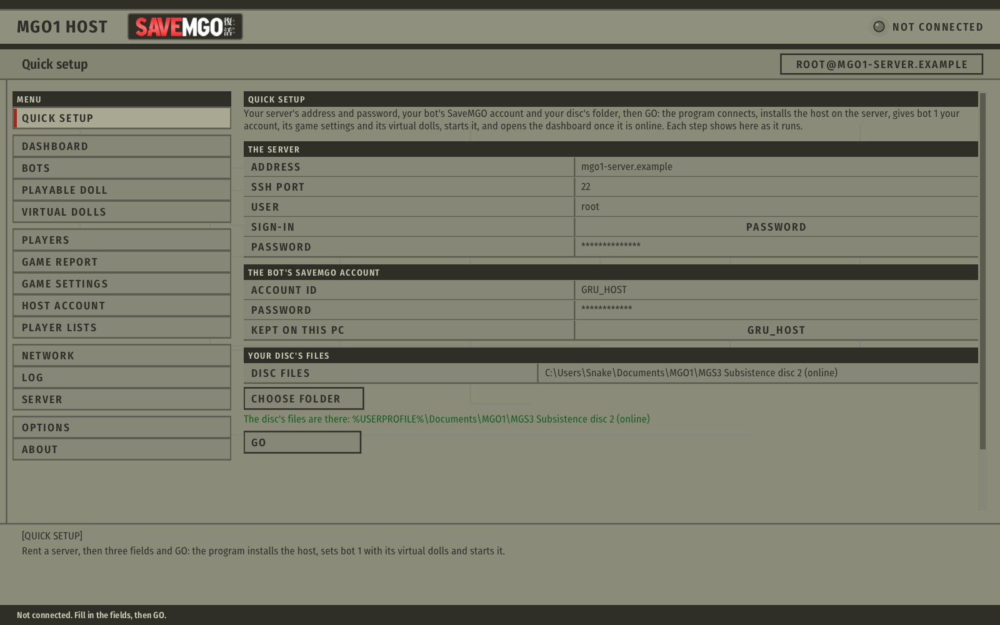
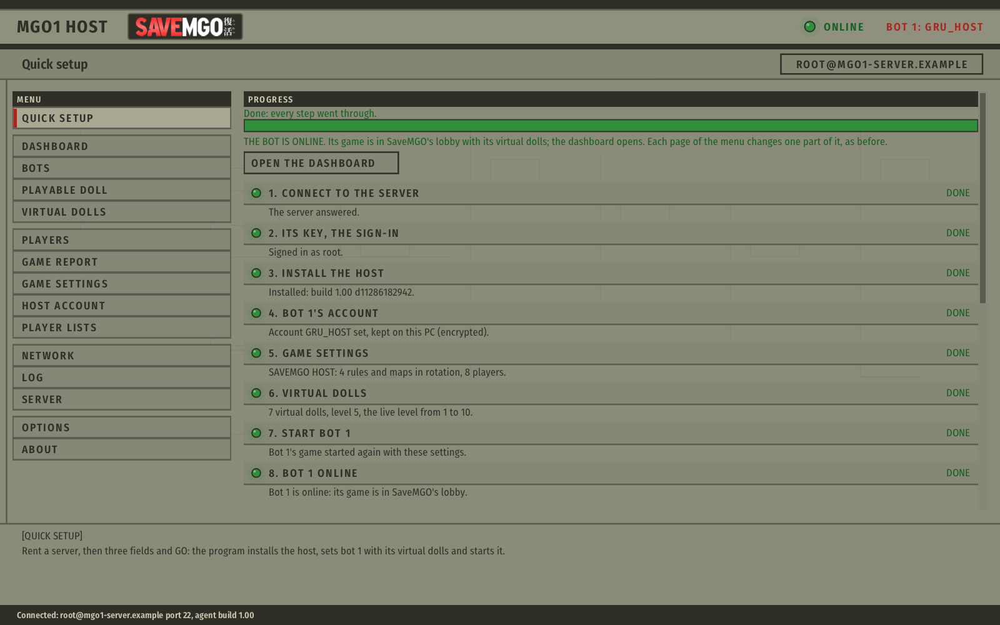

# MGO1 Host build 1.00

This is the first numbered build of MGO1 Host. It runs METAL GEAR ONLINE's own program on your Linux server, so it can
host SaveMGO games around the clock. Bots play by the same rules as real players, and setup takes three clicks.



## Start in three clicks

1. Rent a Linux server: x86-64, Ubuntu 24.04, root access, 2 cores, 2 GB of memory, 3 GB of free disk, and UDP ports
   5730 to 5739 open ([which server to rent](https://github.com/snakeswiss/mgo1-host#which-server-to-rent)).
2. Download MGO1 Host below, unzip it and start `MGO1 Host`. It opens on the QUICK SETUP page.
3. Fill in the three fields and press GO: your server's address and root password, the bot's SaveMGO account, and your
   MGO1 disc's folder (the North American online disc: the folder that holds `MGS` and `MODULES`).

GO installs everything and starts bot 1 with 7 virtual dolls. The first time, your server builds the host from your
disc's files, which takes about 35 minutes on 2 cores. Updates take about 8 minutes.



## Downloads

| File | What it is |
|---|---|
| `MGO1_Host_build-1.00_windows.zip` | MGO1 Host for Windows 10 and 11. Unzip it and start `MGO1 Host.exe`. |
| `MGO1_Host_build-1.00_linux-x86_64.tar.gz` | MGO1 Host for Linux (x86-64). Extract it with `tar xzf`, then run `MGO1 Host/mgo1-host`. |
| `SHA256SUMS_build-1.00.txt` | SHA-256 checksums of the downloads |

The source code is this repository. The "Source code" archives GitHub adds below are the tag's.

The downloads hold no code and no data of the game. The host is built from the game's own code, so it may only be made
from your own disc: MGO1 Host sends your disc's files to your server, which compiles the host from them once. The result
is the same file as the official build 1.00, apart from its build date. If you want to build it yourself, see
[Building](https://github.com/snakeswiss/mgo1-host#building) in the README.

## Updating from a beta

Replace the MGO1 Host folder on your PC with the one from build 1.00 first. Then open the SERVER page and press
UPDATE THE HOST. Your settings, accounts and player lists are kept. On the server, `cat /opt/mgo1host/VERSION` should
now print `build 1.00 ...`.

Keep using the new program after that: a beta's MGO1 Host would take build 1.00 for an older version.

## What's new

- QUICK SETUP gets a host running in three clicks. Each step shows its state. When one fails, the page says what to do,
  and GO starts again from that step.
- Your server builds the host from your disc's files. The North American disc is checked first, and the build runs at
  low priority so bots that are already running come first.
- Every version you can see now says build 1.00: the logs, the program, the server's agent and the VERSION file.
- The bots now play by the exact same rules as you. They eat the food lying on the maps. Their stamina, rolls, flinches,
  falls and respawns work like a player's. They no longer snap back on stairs, they never stand closer to a wall than a
  player can, and their clocks follow real time on a slowed server. Each change has its own switch.

## Checksums

```
f2222f31df20026e81af776ea578cc6c21db4a162f17d49eeea183cfa69ae5d6  MGO1_Host_build-1.00_windows.zip
7d157e95d80c70076315829f209d5e44a48af5d95989ae4c3706c9f6cc969207  MGO1_Host_build-1.00_linux-x86_64.tar.gz
```

---

A free, non-commercial fan project of the SaveMGO community, not affiliated with Konami Digital Entertainment or Sony
Interactive Entertainment. METAL GEAR, METAL GEAR SOLID, METAL GEAR ONLINE and KONAMI are trademarks of Konami Digital
Entertainment Co., Ltd.; PlayStation is a trademark of Sony Interactive Entertainment Inc.
